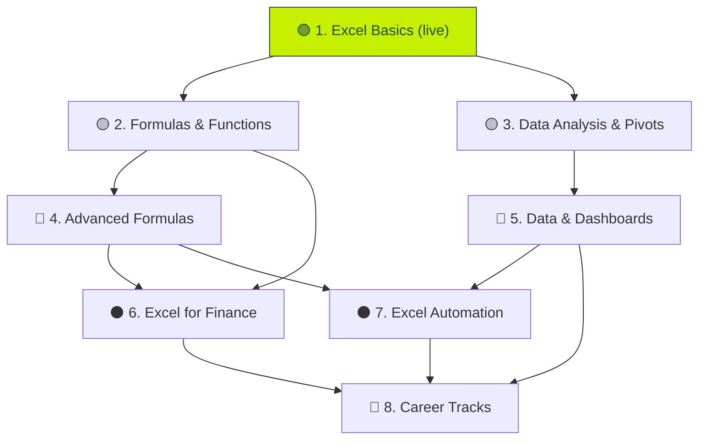
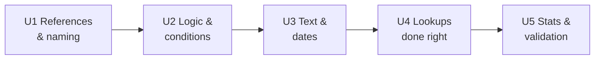
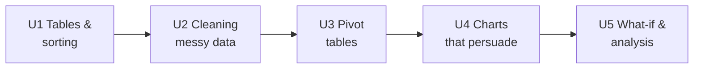
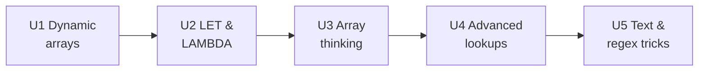
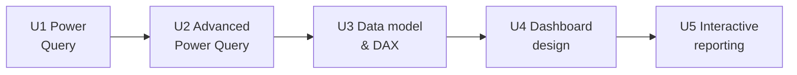

<div align="center">

# 🐼 ExcelPanda — The Next Courses

**What comes after Excel Basics: seven courses, from intermediate to specialist.**

```
   🟡 Intermediate  →  🔴 Advanced  →  ⚫ Specialist  →  💼 Career
```

</div>

> **Written for:** you, the product owner. Course 1 (Excel Basics) is already live and is not repeated here.

## The seven courses

| # | Course | Level | Units | Lessons | Prerequisite |
|--:|--------|:-----:|:-----:|:-------:|--------------|
| 2 | 🟡 [Formulas & Functions](#course-2--formulas--functions-) | Intermediate | 5 | 31 | Excel Basics |
| 3 | 🟡 [Data Analysis & Pivots](#course-3--data-analysis--pivots-) | Intermediate | 5 | 33 | Excel Basics |
| 4 | 🔴 [Advanced Formulas](#course-4--advanced-formulas-) | Advanced | 5 | 30 | Formulas & Functions |
| 5 | 🔴 [Data & Dashboards](#course-5--data--dashboards-) | Advanced | 5 | 30 | Data Analysis & Pivots |
| 6 | ⚫ [Excel for Finance](#course-6--excel-for-finance-) | Specialist | 5 | 29 | Formulas & Functions |
| 7 | ⚫ [Excel Automation](#course-7--excel-automation-) | Specialist | 4 | 24 | Advanced Formulas or Data & Dashboards |
| 8 | 💼 [Career Tracks & Certification](#course-8--career-tracks--certification-) | Mixed | 6 | 30 | Basics + one intermediate course |

Counts include each unit's 🏆 test and are estimates. Legend: 📘 guided lesson · 🎯 challenge · 🐞 fix-the-broken-sheet · 🕵️ real-world case study · 🏆 unit test.



---

## Course 2 · Formulas & Functions 🟡

> *"Stop guessing. Learn the 40 functions that do 90% of real work."*
> **Prerequisite:** Excel Basics · **Slug:** `formulas-functions`



### Unit 1 · References that don't break 🔗
| # | Lesson | You learn | Task |
|--:|--------|-----------|------|
| 1 | Relative vs absolute | `A1`, `$A$1`, `A$1`, and why copying breaks | 📘 Fix a tax formula copied down |
| 2 | The F4 key | Cycle `$` fast | 🎯 Lock a rate cell |
| 3 | Named ranges | `TaxRate` instead of `$B$2` | 📘 Create and use a name |
| 4 | Mixed references | A multiplication table in one formula | 🎯 Build a 9×9 grid |
| 5 | Cross-sheet references | `Sheet2!A1`, 3-D sums | 📘 Combine monthly sheets |
| 6 | 🏆 Unit test | | |

### Unit 2 · Logic & conditions 🔀
| # | Lesson | You learn | Task |
|--:|--------|-----------|------|
| 1 | AND, OR, NOT | Combine tests | 📘 Eligibility checker |
| 2 | Nested IF & IFS | Grade bands without a maze | 📘 Commission tiers |
| 3 | SWITCH | Replace long IF chains | 🎯 Map codes to names |
| 4 | IFERROR & IFNA | Friendly errors | 🐞 Tidy a report full of `#N/A` |
| 5 | SUMIFS · COUNTIFS · AVERAGEIFS | Several conditions at once | 🕵️ Sales by region **and** month |
| 6 | 🏆 Unit test | | |

### Unit 3 · Text & dates 📅
| # | Lesson | You learn | Task |
|--:|--------|-----------|------|
| 1 | LEFT · RIGHT · MID · LEN | Slice text | 🎯 Extract product codes |
| 2 | FIND · SEARCH · SUBSTITUTE | Locate and replace | 🎯 Split `first.last@mail` |
| 3 | TEXTJOIN · CONCAT · `&` | Build labels | 📘 Mail-merge style names |
| 4 | TRIM · CLEAN · PROPER · TEXT | Tidy and format as text | 🐞 Clean an import |
| 5 | Dates are numbers | `TODAY`, `DATE`, `YEAR`, `MONTH`, `DAY` | 📘 Age and tenure |
| 6 | DATEDIF · EDATE · EOMONTH · WORKDAY | Time maths | 🕵️ Invoice due dates |
| 7 | 🏆 Unit test | | |

### Unit 4 · Lookups done right 🔍
| # | Lesson | You learn | Task |
|--:|--------|-----------|------|
| 1 | XLOOKUP deep dive | Exact, approximate, search up/down | 📘 Price list |
| 2 | VLOOKUP & HLOOKUP | Read old workbooks | 🐞 Fix a wrong-column lookup |
| 3 | INDEX + MATCH | The classic two-way lookup | 🎯 Grid lookup |
| 4 | Approximate match | Tax bands, grade bands | 📘 Bonus table |
| 5 | Multi-criteria lookup | Combine columns / helper key | 🕵️ Find a customer's last order |
| 6 | 🏆 Unit test | | |

### Unit 5 · Stats & data validation 📈
| # | Lesson | You learn | Task |
|--:|--------|-----------|------|
| 1 | MEDIAN, MODE, STDEV | Describe a dataset | 🎯 Summarise exam scores |
| 2 | LARGE · SMALL · RANK | Top-N | 🎯 Top 3 salespeople |
| 3 | Rounding & precision | ROUND, CEILING, FLOOR, MROUND | 🐞 Why the total is off by 1p |
| 4 | Data validation | Dropdowns, limits, messages | 📘 Build a safe input form |
| 5 | Conditional formatting | Rules, icon sets, data bars | 📘 Highlight overdue |
| 6 | 🏆 **Final test** | Mixed, 7 tasks | 🏆 + 📜 Certificate |

---

## Course 3 · Data Analysis & Pivots 🟡

> *"Turn 10,000 messy rows into one clear answer."*
> **Prerequisite:** Excel Basics · **Slug:** `data-analysis-pivots`



### Unit 1 · Tables, sorting & filtering 🗂️
| # | Lesson | You learn | Task |
|--:|--------|-----------|------|
| 1 | Format as Table | Structured data, auto-expand | 📘 Convert a range |
| 2 | Sort (single, multi, custom) | Order data | 🎯 Rank by region then revenue |
| 3 | Filter & search | Text, number, date filters | 🎯 Find overdue invoices |
| 4 | Structured references | `Table1[Sales]` | 📘 Formulas that follow the table |
| 5 | Totals row & slicers | Quick summaries | 📘 One-click region view |
| 6 | 🏆 Unit test | | |

### Unit 2 · Cleaning messy data 🧹
| # | Lesson | You learn | Task |
|--:|--------|-----------|------|
| 1 | Remove duplicates | Dedupe safely | 🐞 Mailing list |
| 2 | Text to Columns | Split `Last, First` | 🎯 Split addresses |
| 3 | Flash Fill | Pattern-based cleaning | 🎯 Build usernames |
| 4 | Find & Replace (and wildcards) | Bulk fixes | 🎯 Normalise country names |
| 5 | Dates and numbers stored as text | Convert reliably | 🐞 The sheet that will not add up |
| 6 | Handling blanks and errors | `ISBLANK`, fill down | 🕵️ Repair a survey export |
| 7 | 🏆 Unit test | | |

### Unit 3 · Pivot tables 🧮
| # | Lesson | You learn | Task |
|--:|--------|-----------|------|
| 1 | Your first pivot | Rows, columns, values, filters | 📘 Sales by region |
| 2 | Summarise by | Sum, count, average, % of total | 🎯 Share of revenue |
| 3 | Grouping | Dates → months/quarters, number bands | 🎯 Monthly trend |
| 4 | Calculated fields & items | Margin, per-unit price | 📘 Profit % in a pivot |
| 5 | Slicers & timelines | Interactive filters | 📘 Click-to-filter report |
| 6 | Refresh & data source | Keep a pivot current | 🐞 Pivot shows old numbers |
| 7 | 🏆 Unit test | | |

### Unit 4 · Charts that persuade 📊
| # | Lesson | You learn | Task |
|--:|--------|-----------|------|
| 1 | Pick the right chart | Column vs line vs bar vs pie | 🎯 Chart the right thing |
| 2 | Build & edit a chart | Titles, axes, legends | 📘 Monthly revenue |
| 3 | Combo & secondary axis | Two measures, one chart | 📘 Revenue vs margin % |
| 4 | Sparklines & mini charts | Trends in a cell | 🎯 One-cell trend per row |
| 5 | Design for clarity | Colour, labels, remove clutter | 🐞 Fix an ugly chart |
| 6 | Pivot charts | Charts that follow a pivot | 📘 |
| 7 | 🏆 Unit test | | |

### Unit 5 · What-if & analysis 🧠
| # | Lesson | You learn | Task |
|--:|--------|-----------|------|
| 1 | Goal Seek | Solve backwards | 🎯 Price needed for 20% margin |
| 2 | Scenarios | Best / base / worst | 📘 Budget scenarios |
| 3 | Data tables | Sensitivity grid | 📘 Price × volume |
| 4 | Trendlines & forecasting | `FORECAST`, `TREND` | 🎯 Next quarter estimate |
| 5 | Correlation & regression basics | `CORREL`, `SLOPE` | 🕵️ Does ad spend drive sales? |
| 6 | 🏆 **Final test** | Case study on a raw export | 🏆 + 📜 Certificate |

---

## Course 4 · Advanced Formulas 🔴

> *"The modern Excel: dynamic arrays, LET and LAMBDA."*
> **Prerequisite:** Formulas & Functions · **Slug:** `advanced-formulas` *(shell already in the database)*



### Unit 1 · Dynamic arrays 🌊
| # | Lesson | You learn | Task |
|--:|--------|-----------|------|
| 1 | Spill ranges | One formula, many cells; the `#` operator | 📘 |
| 2 | SORT · SORTBY | Live sorted lists | 🎯 Leaderboard |
| 3 | FILTER | Return rows that match | 🎯 All orders over £500 |
| 4 | UNIQUE | Distinct lists, counts | 🎯 Customer list |
| 5 | SEQUENCE · RANDARRAY | Generate rows, calendars | 📘 Auto-built timeline |
| 6 | 🏆 Unit test | | |

### Unit 2 · LET & LAMBDA 🧬
| # | Lesson | You learn | Task |
|--:|--------|-----------|------|
| 1 | LET | Name intermediate results | 📘 Readable formula |
| 2 | LAMBDA basics | Your own functions | 📘 `TAX(amount)` |
| 3 | MAP · REDUCE · SCAN | Loop over arrays | 🎯 Running totals |
| 4 | BYROW · BYCOL · MAKEARRAY | Row-wise logic | 🎯 Row max without helpers |
| 5 | Reusable function libraries | Name Manager, share LAMBDAs | 📘 |
| 6 | 🏆 Unit test | | |

### Unit 3 · Array thinking 🧠
| # | Lesson | You learn | Task |
|--:|--------|-----------|------|
| 1 | Boolean arithmetic | `(A=B)*1`, multiply conditions | 📘 |
| 2 | SUMPRODUCT | The Swiss-army formula | 🎯 Weighted average |
| 3 | Array constants & `{}` | Inline lists | 🎯 Multi-criteria COUNT |
| 4 | TAKE · DROP · CHOOSECOLS · HSTACK · VSTACK | Reshape data | 📘 Combine two lists |
| 5 | TOCOL · TOROW · WRAPROWS | Flatten and re-wrap | 🐞 Fix a pivoted export |
| 6 | 🏆 Unit test | | |

### Unit 4 · Advanced lookups 🧲
| # | Lesson | You learn | Task |
|--:|--------|-----------|------|
| 1 | XLOOKUP arrays & wildcards | Return many columns | 📘 |
| 2 | XMATCH | Position lookups, search modes | 🎯 |
| 3 | Two-way & nearest-match | Closest date/price | 🎯 |
| 4 | INDIRECT & OFFSET (and why to avoid them) | Dynamic references | 🐞 Volatile formula slows the file |
| 5 | Lookup across many sheets | Consolidate | 🕵️ |
| 6 | 🏆 Unit test | | |

### Unit 5 · Text, regex & errors 🔤
| # | Lesson | You learn | Task |
|--:|--------|-----------|------|
| 1 | TEXTSPLIT · TEXTBEFORE · TEXTAFTER | Parse text | 🎯 |
| 2 | REGEX functions | Pattern matching | 🎯 Extract phone numbers |
| 3 | Debugging long formulas | Evaluate Formula, F9, trace precedents | 🐞 ×3 |
| 4 | Performance | Volatile functions, whole-column refs | 🕵️ Speed up a slow model |
| 5 | Error-proofing | Defensive formulas | 📘 |
| 6 | 🏆 **Final test** | Boss challenge | 🏆 + 📜 |

---

## Course 5 · Data & Dashboards 🔴

> *"Import anything. Model it. Present it to executives."*
> **Prerequisite:** Data Analysis & Pivots · **Slug:** `data-dashboards` *(shell already in the database)*



### Unit 1 · Power Query basics 🔌
| # | Lesson | You learn | Task |
|--:|--------|-----------|------|
| 1 | Get data | CSV, Excel, web, folders | 📘 |
| 2 | The Query Editor | Applied steps, undo-able cleaning | 📘 |
| 3 | Transform columns | Split, trim, type, replace | 🎯 |
| 4 | Filter & remove rows | Top/bottom, blanks, errors | 🎯 |
| 5 | Close & load | Refresh in one click | 🐞 Broken refresh |
| 6 | 🏆 Unit test | | |

### Unit 2 · Advanced Power Query ⚙️
| # | Lesson | You learn | Task |
|--:|--------|-----------|------|
| 1 | Merge queries | Joins (left, inner, anti) | 📘 Orders + customers |
| 2 | Append queries | Stack monthly files | 🎯 |
| 3 | Unpivot / pivot | Reshape wide ↔ long | 🎯 |
| 4 | Custom & conditional columns | Add logic | 🎯 |
| 5 | Parameters & folder import | Automate a monthly refresh | 🕵️ |
| 6 | 🏆 Unit test | | |

### Unit 3 · The data model & DAX 🧱
| # | Lesson | You learn | Task |
|--:|--------|-----------|------|
| 1 | Why a data model | Tables + relationships | 📘 |
| 2 | Star schema | Fact vs dimension tables | 🎯 Design a model |
| 3 | Relationships | One-to-many, filter direction | 🐞 Pivot shows duplicates |
| 4 | DAX measures | `SUM`, `CALCULATE`, `DIVIDE` | 📘 |
| 5 | Time intelligence | `SAMEPERIODLASTYEAR`, YTD | 🎯 Year-over-year |
| 6 | 🏆 Unit test | | |

### Unit 4 · Dashboard design 🎨
| # | Lesson | You learn | Task |
|--:|--------|-----------|------|
| 1 | Start with the question | Audience, decision, KPIs | 🕵️ |
| 2 | KPI cards | Big number + delta + sparkline | 📘 |
| 3 | Layout & hierarchy | Grid, whitespace, reading order | 🐞 Redesign a cluttered sheet |
| 4 | Colour & accessibility | Palettes, contrast, colour-blind safe | 🎯 |
| 5 | Storytelling | Headlines that say the insight | 📘 |
| 6 | 🏆 Unit test | | |

### Unit 5 · Interactive reporting 🎛️
| # | Lesson | You learn | Task |
|--:|--------|-----------|------|
| 1 | Slicers across pivots | Connected filters | 📘 |
| 2 | Dropdown-driven views | Validation + dynamic formulas | 🎯 |
| 3 | Form controls | Buttons, checkboxes, scroll bars | 📘 |
| 4 | Print, PDF & share | Page setup, protect, publish | 🎯 |
| 5 | **Capstone** | Build an executive dashboard from raw data | 🕵️ |
| 6 | 🏆 **Final test** | | 🏆 + 📜 |

---

## Course 6 · Excel for Finance ⚫

> *"Build models a bank would trust."*
> **Prerequisite:** Formulas & Functions · **Slug:** `excel-finance`

### Unit 1 · Time value of money 💷
| # | Lesson | You learn | Task |
|--:|--------|-----------|------|
| 1 | Simple & compound interest | Growth formulas | 📘 |
| 2 | PV · FV · PMT · NPER · RATE | The five core functions | 🎯 ×3 |
| 3 | Loan schedules | Amortisation table | 📘 Build one row, fill down |
| 4 | NPV & IRR | Judge an investment | 🎯 |
| 5 | XNPV & XIRR | Irregular cash flows | 🎯 |
| 6 | 🏆 Unit test | | |

### Unit 2 · Budgets & forecasts 🧾
| # | Lesson | You learn | Task |
|--:|--------|-----------|------|
| 1 | Budget layout | Inputs / calcs / outputs separation | 📘 |
| 2 | Variance analysis | Actual vs budget, % and £ | 🎯 |
| 3 | Rolling forecasts | `OFFSET`-free forecasting | 📘 |
| 4 | Seasonality | Index and adjust | 🎯 |
| 5 | Cash-flow forecast | Opening / closing balance | 🕵️ |
| 6 | 🏆 Unit test | | |

### Unit 3 · Financial statements 📑
| # | Lesson | You learn | Task |
|--:|--------|-----------|------|
| 1 | Income statement | Revenue → net profit | 📘 |
| 2 | Balance sheet | Assets = liabilities + equity | 📘 |
| 3 | Cash-flow statement | Indirect method | 📘 |
| 4 | Linking the three | One model, three statements | 🕵️ |
| 5 | Ratios | Margins, liquidity, leverage | 🎯 |
| 6 | 🏆 Unit test | | |

### Unit 4 · Modelling best practice 🏗️
| # | Lesson | You learn | Task |
|--:|--------|-----------|------|
| 1 | Colour conventions | Blue inputs, black formulas | 🐞 Audit a model |
| 2 | Checks & balances | Error flags, reconciliations | 📘 |
| 3 | Named ranges & structure | Readable models | 🎯 |
| 4 | Scenario switch | One dropdown flips the model | 📘 |
| 5 | Sensitivity & Monte-Carlo intro | Data tables, `RAND` | 🎯 |
| 6 | 🏆 Unit test | | |

### Unit 5 · Capstones 🏁
| # | Lesson | Project |
|--:|--------|---------|
| 1 | 🕵️ Startup financial model | 3-year plan with scenarios |
| 2 | 🕵️ Loan comparison tool | Dropdown-driven comparison |
| 3 | 🕵️ Valuation basics | DCF with sensitivity |
| 4 | 🕵️ Personal finance planner | Budget + goals |
| 5 | 🏆 **Final test** | 🏆 + 📜 |

---

## Course 7 · Excel Automation ⚫

> *"Stop doing it by hand. Record it. Script it. Schedule it."*
> **Prerequisite:** Advanced Formulas or Data & Dashboards · **Slug:** `excel-automation`

### Unit 1 · Speed without code ⚡
| # | Lesson | You learn | Task |
|--:|--------|-----------|------|
| 1 | Templates & styles | Reusable formats | 📘 |
| 2 | Custom number formats | `0.0,"k"`, colours, dates | 🎯 |
| 3 | Paste Special mastery | Values, transpose, operations | 🎯 |
| 4 | Quick Access & custom shortcuts | Make Excel yours | 📘 |
| 5 | Go To Special & Find Select | Select all blanks / formulas | 🎯 |
| 6 | 🏆 Unit test | | |

### Unit 2 · Macros (recorder) 🎥
| # | Lesson | You learn | Task |
|--:|--------|-----------|------|
| 1 | What a macro is | Record, run, save | 📘 |
| 2 | Absolute vs relative recording | Why macros break | 🐞 |
| 3 | Buttons & shortcuts | Run macros easily | 📘 |
| 4 | Reading recorded code | First look at VBA | 📘 |
| 5 | Macro security | Trusted locations | 📘 |
| 6 | 🏆 Unit test | | |

### Unit 3 · VBA fundamentals 🧑‍💻
| # | Lesson | You learn | Task |
|--:|--------|-----------|------|
| 1 | The VBA editor | Modules, procedures | 📘 |
| 2 | Variables & data types | `Dim`, `Long`, `String` | 🎯 |
| 3 | Ranges & cells | `Range`, `Cells`, `Offset` | 🎯 |
| 4 | Loops & conditions | `For`, `Do While`, `If` | 🎯 |
| 5 | Functions & UDFs | Your own worksheet function | 📘 |
| 6 | Errors & debugging | Breakpoints, `On Error` | 🐞 |
| 7 | 🏆 Unit test | | |

### Unit 4 · Modern automation 🤖
| # | Lesson | You learn | Task |
|--:|--------|-----------|------|
| 1 | Office Scripts basics | TypeScript for Excel on the web | 📘 |
| 2 | Power Automate flows | Trigger a refresh and email | 📘 |
| 3 | Automating Power Query refresh | Scheduled reports | 🕵️ |
| 4 | **Capstone** | One-click monthly report | 🕵️ |
| 5 | 🏆 **Final test** | | 🏆 + 📜 |


---

## Course 8 · Career Tracks & Certification 💼

> *"Use Excel the way your job does."*
> **Prerequisite:** Excel Basics + one intermediate course · **Slug:** `career-tracks`

| Track | Units | Signature projects |
|-------|-------|--------------------|
| 📣 **Marketing analyst** | Campaign tracking · Funnel & CAC/LTV · A/B test maths · Reporting | Ad-spend dashboard, funnel conversion sheet |
| 💰 **Sales & revenue ops** | Pipeline · Quota & commission · Forecasting · Territory analysis | Commission calculator, pipeline forecast |
| 👥 **HR & people analytics** | Headcount · Attrition · Payroll basics · Surveys | Turnover report, salary band tool |
| 📦 **Operations & supply chain** | Inventory · Reorder points · Capacity planning · KPIs | Stock-out predictor, shift planner |
| 🧾 **Accounting** | Reconciliation · Accruals · Depreciation · Audit trails | Bank rec, depreciation schedule |
| 🎓 **Students & researchers** | Cleaning survey data · Statistics · Charts for papers | Thesis dataset pack |

### 🎖️ Certification prep (separate unit)

| # | Lesson | Purpose |
|--:|--------|---------|
| 1 | Exam map | What the Microsoft Office Specialist (Excel Associate / Expert) objectives cover |
| 2 | Timed practice sets ×4 | Same style: 15–20 tasks in 50 minutes |
| 3 | Weak-spot review | The app replays the tasks you got wrong |
| 4 | Full mock exam ×2 | Score report with per-objective breakdown |
| 5 | 🏆 **ExcelPanda Certificate** | Shareable, verifiable page for LinkedIn |

### 💼 Interview prep

Spreadsheet take-home tests, 10 "classic interview" Excel questions, a 30-minute case study.
